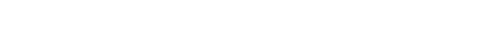
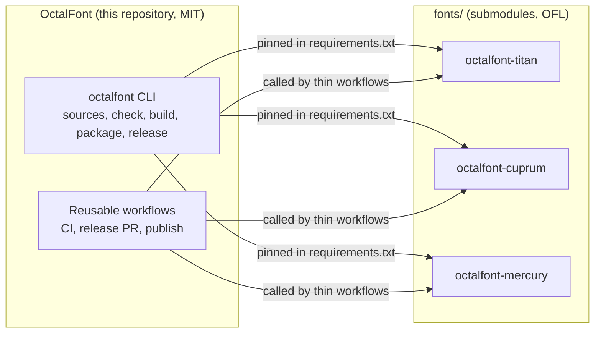

<!--suppress HtmlDeprecatedAttribute, HtmlUnknownTarget -->
<div align="center">
  <!--
  =====================
         HEADER
  =====================
  -->
  <br />
  <a rel="noopener noreferrer" href="https://github.com/OctalMesh/OctalFont">
    <picture>
      <source media="(prefers-color-scheme: light)" srcset="assets/logo/svg/octalfont.svg">
      <source media="(max-width: 480px)" srcset="assets/logo/svg/octal_font_center_white.svg">
      
    </picture>
  </a>
  <br /><br /><br />
  <!--
  =====================
         BADGES
  =====================
  -->
  <div>
    <!-- Repo Stars Badge -->
    <a rel="noopener noreferrer" href="https://github.com/OctalMesh/OctalFont/stargazers">
      <picture>
        <source media="(prefers-color-scheme: light)" srcset="https://img.shields.io/github/stars/OctalMesh/OctalFont?style=for-the-badge&logo=starship&color=363636&labelColor=464646" />
        
      </picture>
    </a>
    <!-- Repo Contributors Badge -->
    <a rel="noopener noreferrer" href="https://github.com/OctalMesh/OctalFont/contributors">
      <picture>
        <source media="(prefers-color-scheme: light)" srcset="https://img.shields.io/github/contributors/OctalMesh/OctalFont?style=for-the-badge&logo=githubsponsors&logoColor=fff&color=363636&labelColor=464646" />
        
      </picture>
    </a>
    <!-- Repo Views Badge -->
    <a rel="noopener noreferrer" href="https://hits.sh/github.com/OctalMesh/OctalFont">
      <picture>
        <source media="(prefers-color-scheme: light)" srcset="https://hits.sh/github.com/OctalMesh/OctalFont.svg?style=for-the-badge&label=Views&logo=github&color=363636&labelColor=464646" />
        
      </picture>
    </a>
  </div>
  <h1></h1>
  <!--
  =====================
         SOURCES
  =====================
  -->
  <h6>
    <br />
    <a rel="noopener noreferrer" href="CODE_OF_CONDUCT.md">Code of Conduct</a>
    ·
    <a rel="noopener noreferrer" href="CONTRIBUTING.md">Contributing</a>
    ·
    <a rel="noopener noreferrer" href="SUPPORT.md">Support</a>
    ·
    <a rel="noopener noreferrer" href="SECURITY.md">Security</a>
    ·
    <a rel="noopener noreferrer" href="RELEASING.md">Releasing</a>
    ·
    <a rel="noopener noreferrer" href="LICENSE.md">License MIT</a>
    <br />
    <a rel="noopener noreferrer" href="docs/README.md">Full Documentation</a>
    ·
    <a rel="noopener noreferrer" href="docs/design/README.md">Design Overview</a>
    ·
    <a rel="noopener noreferrer" href="docs/technical/build.md">Build Guide</a>
    ·
    <a rel="noopener noreferrer" href="CHANGELOG.md">Changelog</a>
    <br /><br />
  </h6>
</div>

<div align="justify">
  <!--
  =====================
       DESCRIPTION
  =====================
  -->
  <p>
    <strong>OctalFont</strong> is the home of the Octal typeface families,
    developed as part of the <a rel="noopener noreferrer" href="https://octalmesh.com">OctalMesh</a>
    design system, and of the <code>octalfont</code> tool that builds them.
    Every glyph originates as a hand-drawn sketch, gets refined as a clean
    vector, and is compiled into TTF files by a fully automated pipeline: SVG
    drawings become UFO masters, composite glyphs and OpenType features are
    generated, and <a rel="noopener noreferrer" href="https://github.com/googlefonts/gftools">gftools</a>
    builds the binaries.
    <br /><br />
    Each family is a separate repository, mounted here under <code>fonts/</code>
    as a Git submodule. The families are named after a material whose physical
    character mirrors the visual personality of the font: <em>Titan</em>,
    <em>Cuprum</em>, <em>Mercury</em>.
  </p>
</div>

<div align="center">
  <h2>Font Families</h2>
</div>

| Family            | Repository                                                            | Named after | Character                                                                |
|-------------------|-----------------------------------------------------------------------|-------------|--------------------------------------------------------------------------|
| **Octal Titan**   | [`octalfont-titan`](https://github.com/OctalMesh/octalfont-titan)     | Titanium    | Monospaced geometric display face of straight strokes and sharp corners. |
| **Octal Cuprum**  | [`octalfont-cuprum`](https://github.com/OctalMesh/octalfont-cuprum)   | Copper      | Thin, neutral, monospaced, with a weight axis (Light, Regular, Bold).    |
| **Octal Mercury** | [`octalfont-mercury`](https://github.com/OctalMesh/octalfont-mercury) | Mercury     | Rounded, fluid typeface derived from Titan.                              |

All families are released under the [SIL Open Font License 1.1](docs/licensing.md).

<div align="center">
  <h2>How It Fits Together</h2>
</div>



The font repositories are completely independent: each one carries its sources, its
`OFL.txt` and its history. The only thing they take from this repository is the build tool
(pinned to a release tag in their `requirements.txt`) and the shared workflow logic.

<div align="center">
  <h2>Quick Start</h2>
</div>

**Build a font** (needs Python 3.10+ and Git):

```sh
git clone https://github.com/OctalMesh/octalfont-titan && cd octalfont-titan
python -m venv .venv && . .venv/bin/activate     # Windows: .venv\Scripts\activate
pip install -r requirements.txt                  # installs the pinned octalfont[build]
octalfont check --missing                        # checks legal files, vertical metrics and glyph-set coverage
octalfont build                                  # writes fonts/ttf/*.ttf
```

**Work on the tool and the fonts together:**

```sh
git clone --recurse-submodules https://github.com/OctalMesh/OctalFont && cd OctalFont
python -m venv .venv && . .venv/bin/activate
pip install -e ".[build,test]"                   # editable install
octalfont -C fonts/titan check                   # run any command against a family
pytest                                           # the tool's tests
```

| Command                 | What it does                                                          |
|-------------------------|-----------------------------------------------------------------------|
| `octalfont sources`     | SVG -> UFO masters, composites, designspace and gftools `config.yaml` |
| `octalfont check`       | legal files, vertical metrics and glyph-set coverage against          |
| `octalfont build`       | sources + gftools builder + `meta` table; fonts land in `fonts/`      |
| `octalfont package`     | `Family-vX.YYY.zip` in the root, ready for release                    |
| `octalfont npm`         | self-hostable npm package (WOFF2 + CSS) from the built fonts          |
| `octalfont release ...` | changesets, versioning and release gates                              |

Details, options and troubleshooting: [Build Guide](docs/technical/build.md) and
[Configuration](docs/technical/configuration.md).

<div align="center">
  <h2>Use the Fonts in Your Project</h2>
</div>

<div align="justify">
  <p>
    Every font release is also published as an npm package of self-hosted WOFF2 files, split by
    script and shipped with ready-made CSS. Your project serves the font from its own origin:
    no third-party requests, no extra setup.
  </p>
</div>

| Family            | Package                                                                              |
|-------------------|--------------------------------------------------------------------------------------|
| **Octal Titan**   | [`@octalmesh/octal-titan`](https://www.npmjs.com/package/@octalmesh/octal-titan)     |
| **Octal Cuprum**  | [`@octalmesh/octal-cuprum`](https://www.npmjs.com/package/@octalmesh/octal-cuprum)   |
| **Octal Mercury** | [`@octalmesh/octal-mercury`](https://www.npmjs.com/package/@octalmesh/octal-mercury) |

```sh
npm install @octalmesh/octal-titan
```

```js
import "@octalmesh/octal-titan";   // all subsets; or "@octalmesh/octal-titan/latin.css"
```

The packages appear with the first published release of each family. The package
is a plain redistribution under the OFL: names, metadata and the license file
are unchanged, and upstream layout (`fonts/`, `OFL.txt`, the release archive)
stays the source of truth.

How packages are built and published: [RELEASING.md](RELEASING.md).

<div align="center">
  <h2>Repository Layout</h2>
</div>

```text
OctalFont/
├── src/octalfont/      the tool (sources, check, build, package, release)
│   └── data/glyphsets/ Google Fonts glyph sets shipped with the tool
├── tests/              pytest suite
├── fonts/              font families, one Git submodule each
│   ├── titan/          sources/{ai,svg,ufo}, font.yaml, OFL.txt, workflows
│   ├── cuprum/
│   └── mercury/
├── docs/               design and technical documentation
├── assets/             logos and branding
├── .changeset/         pending changesets and release configuration
├── .github/workflows/  CI, release automation and reusable workflows
└── RELEASING.md        how releases happen
```

<div align="center">
  <h2>Development</h2>
</div>

```sh
pip install -e ".[test,lint]"
pytest                            # tests
ruff check .                      # lint
octalfont release add             # describe your change (required for package changes)
```

Pull requests target `dev` and carry a **changeset**; the rest of the release is
automated by the `octal-automation` GitHub App. Read
[CONTRIBUTING.md](CONTRIBUTING.md) before you start.

<div align="center">
  <h2>Releases</h2>
</div>

<div align="justify">
  <p>
    The tool uses <a rel="noopener noreferrer" href="https://semver.org">SemVer</a>
    (<code>v0.1.0</code>); a font uses Google Fonts-style <code>MAJOR.MINOR</code>
    versions (<code>v1.001</code>). In both cases a changeset decides the bump,
    a bot-maintained draft pull request ships it, and the release is distributed
    when a maintainer publishes the draft GitHub Release. The wheel and sdist of
    the tool, and the font archives, are attached to the Releases with a
    build-provenance attestation. The whole flow is described in
    <a rel="noopener noreferrer" href="RELEASING.md">RELEASING.md</a>.
  </p>
</div>

<div align="center">
  <!--
  =====================
         FOOTER
  =====================
  -->
  <h1></h1>
  <br />
  <!-- OctalMesh Logo -->
  <a rel="noopener noreferrer" target="_blank" href="https://octalmesh.com">
    <picture>
      <source media="(prefers-color-scheme: light)" srcset="https://raw.githubusercontent.com/OctalMesh/OctalDesign/release/assets/logo/svg/octal_mesh_center.svg" />
      
    </picture>
  </a>
  <br /><br />
  <!-- Socials -->
  <div>
    <!-- Telegram Badge -->
    <a rel="noopener noreferrer" target="_blank" href="https://octalmesh.com/telegram">
      <picture>
        <source media="(prefers-color-scheme: light)" srcset="https://raw.githubusercontent.com/OctalMesh/OctalDesign/release/assets/icon/svg/telegram.svg" />
        
      </picture>
    </a>
    &nbsp;
    <!-- YouTube Badge -->
    <a rel="noopener noreferrer" target="_blank" href="https://octalmesh.com/youtube">
      <picture>
        <source media="(prefers-color-scheme: light)" srcset="https://raw.githubusercontent.com/OctalMesh/OctalDesign/release/assets/icon/svg/youtube.svg" />
        
      </picture>
    </a>
    &nbsp;
    <!-- TikTok Badge -->
    <a rel="noopener noreferrer" target="_blank" href="https://octalmesh.com/tiktok">
      <picture>
        <source media="(prefers-color-scheme: light)" srcset="https://raw.githubusercontent.com/OctalMesh/OctalDesign/release/assets/icon/svg/tiktok.svg" />
        
      </picture>
    </a>
    &nbsp;
    <!-- Instagram Badge -->
    <a rel="noopener noreferrer" target="_blank" href="https://octalmesh.com/instagram">
      <picture>
        <source media="(prefers-color-scheme: light)" srcset="https://raw.githubusercontent.com/OctalMesh/OctalDesign/release/assets/icon/svg/instagram.svg" />
        
      </picture>
    </a>
    &nbsp;
    <!-- X Badge -->
    <a rel="noopener noreferrer" target="_blank" href="https://octalmesh.com/x">
      <picture>
        <source media="(prefers-color-scheme: light)" srcset="https://raw.githubusercontent.com/OctalMesh/OctalDesign/release/assets/icon/svg/x.svg" />
        
      </picture>
    </a>
    &nbsp;
    <!-- Reddit Badge -->
    <a rel="noopener noreferrer" target="_blank" href="https://octalmesh.com/reddit">
      <picture>
        <source media="(prefers-color-scheme: light)" srcset="https://raw.githubusercontent.com/OctalMesh/OctalDesign/release/assets/icon/svg/reddit.svg" />
        
      </picture>
    </a>
  </div>
  <h6>
    • • •
    <br /><br />
    The tool in this repository is licensed under the <a rel="noopener noreferrer" href="LICENSE.md">MIT License</a>.
    Every font family is licensed under the <a rel="noopener noreferrer" href="docs/licensing.md">SIL Open Font License 1.1</a>
    in its own repository.
    <br /><br />
    <ul align="justify">
      <li>You may freely use, modify, and distribute the code under the MIT License.</li>
      <li>The fonts allow use, modification, and embedding, provided the license and attribution are retained.</li>
      <li>Modified versions of a font must be released under the OFL.</li>
      <li>Both code and fonts are provided "as is" without warranties.</li>
    </ul>
  </h6>
</div>
