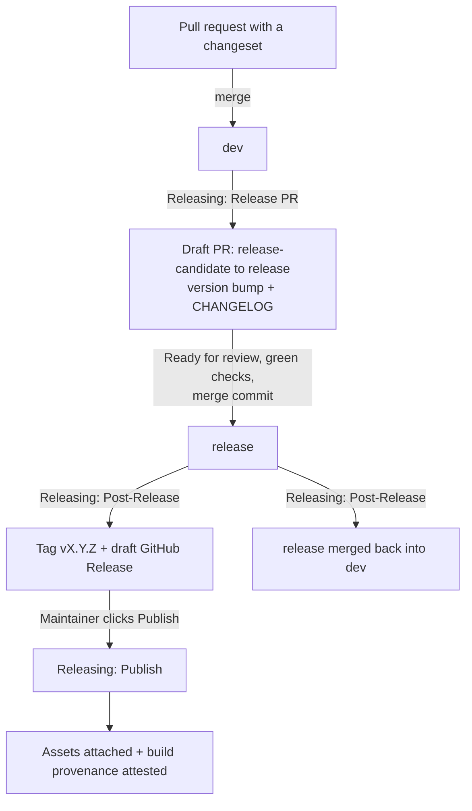

<!--suppress HtmlDeprecatedAttribute -->
<h1 align="center">Releasing</h1>

This document describes how OctalFont and the font repositories are versioned
and released. The flow is the same everywhere: **changesets** decide the version,
a bot-maintained **release pull request** ships it, and a deliberate click on
**Publish** distributes it.

> [!NOTE]
> Everything is automated by the `octal-automation` GitHub App. You write a
> changeset and merge pull requests; you never edit versions, changelogs or tags
> by hand.

## Overview

|                  | OctalFont (the tool)      | Font repositories                                               |
|------------------|---------------------------|-----------------------------------------------------------------|
| Version scheme   | SemVer `X.Y.Z`            | `MAJOR.MINOR` with a three-digit minor, `1.001`                 |
| Version lives in | `pyproject.toml`          | `sources/font.yaml`                                             |
| Tag              | `v0.1.0`                  | `v1.001`                                                        |
| Bump levels      | `patch`, `minor`, `major` | `minor` (`patch` is an alias), `major`                          |
| Release asset    | wheel + sdist             | `<Family>-v1.001.zip` (Google Fonts layout) and the npm tarball |
| Registry         | git tag, optional PyPI    | npm: `@octalmesh/octal-titan` (opt-in)                          |
| Changelog        | `CHANGELOG.md`            | `CHANGELOG.md`                                                  |

Branches:

| Branch              | Role                                                                  |
|---------------------|-----------------------------------------------------------------------|
| `dev`               | Integration branch. All pull requests target it.                      |
| `release-candidate` | Bot-owned, rebuilt on every push to `dev`. Never push to it.          |
| `release`           | The last shipped state. Only the release pull request merges into it. |

## How a release happens



### Which bump?

The highest level among the pending changesets wins.

| Level   | Tool                                                          | Font                                     |
|---------|---------------------------------------------------------------|------------------------------------------|
| `patch` | bug fix, internal change                                      | same as `minor`                          |
| `minor` | new command, option or check; backwards compatible            | fixes, spacing, kerning, small additions |
| `major` | breaking change (renamed command, changed `font.yaml` format) | redesign, new glyph set, new axis        |

`0.x` follows the same rules: `major` from `0.4.2` gives `1.0.0`.

## Workflows

| Workflow                                             | Trigger                                        | Result                                                                                    |
|------------------------------------------------------|------------------------------------------------|-------------------------------------------------------------------------------------------|
| `CI: Test`, `CI: Build`, `CI: Quality`, `CI: CodeQL` | push and pull request to `dev` / `release`     | checks (tool repository)                                                                  |
| `CI: Build`                                          | push and pull request to `dev` / `release`     | sources fresh, `octalfont check`, build, Font Bakery, changeset check (font repositories) |
| `Releasing: Release PR`                              | push to `dev`                                  | draft release pull request, rebuilt                                                       |
| `Releasing: Readiness`                               | pull request into `release`                    | version moved forward, changelog present, no changeset left                               |
| `Releasing: Post-Release`                            | push to `release`                              | tag, draft GitHub Release, sync into `dev`                                                |
| `Releasing: Publish`                                 | GitHub Release published                       | build, attest, attach assets; fonts: npm package, optional npm publish                    |
| `Releasing: Checklist`                               | CI workflow finished, release PR ready / draft | ticks or unticks the "Before merging" boxes of the release PR                             |
| `Project: Sync`                                      | pull request events; GitHub Release published  | labels, project fields and Status of pull requests and issues; `Released` on publish      |
| `Dependabot: Auto-merge`                             | Dependabot pull request into `dev`             | auto-merge for patch-only updates                                                         |

The logic of the release workflows lives once, in OctalFont. Font repositories
contain only thin callers that pin a tag of this repository.

Skip tags work in commit messages and pull request titles: `[ci-skip]` skips
every CI workflow, `[test-skip]`, `[build-skip]`, `[quality-skip]` and
`[ql-skip]` skip one. Release workflows ignore them.

## Pull requests and the project board

### Pull request titles

Titles follow `type(scope): summary`, for example
`feat(titan): add Cyrillic Plus glyphs`. They become the lines of the generated
release notes, so write them as a changelog entry. The release pull request is
named by the bot: `release: OctalFont v0.1.0`.

| Type                                                        | Label         | Release notes section | Default priority |
|-------------------------------------------------------------|---------------|-----------------------|------------------|
| `feat`                                                      | Suggestion    | New features          | Medium           |
| `fix`                                                       | Bug           | Bug fixes             | High             |
| `docs`                                                      | Documentation | Documentation         | Low              |
| `style`, `refactor`, `perf`, `test`, `build`, `ci`, `chore` | Maintenance   | Maintenance           | Low              |
| `chore(deps)`                                               | Dependencies  | Dependencies          | Low              |
| `release`                                                   | Release       | excluded              | High             |

The **PR Title** check of `Project: Sync` fails on any other format. Bots are
exempt. Skip tags (`[ci-skip]`, ...) may still be appended to the summary.

### What `Project: Sync` does

It adds every pull request to the GitHub project and keeps the fields in step.
Issues closed by a pull request (`Closes #123` in its description) follow its
Status.

| Event                                    | Status        |
|------------------------------------------|---------------|
| pull request opened or reopened          | `In Progress` |
| pull request merged into `dev`           | `Staging`     |
| GitHub Release published (the PRs in it) | `Released`    |

`Backlog` and `To-Do` are set by hand. A pull request closed without merging is
left alone (use the project's *Auto-archive* workflow for those).

- **Size** is recomputed on every update from the changed lines: up to 50 is
  `Size: Small`, up to 300 `Size: Medium`, more `Size: Large`. `CHANGELOG.md`,
  changesets, lock files and `*.ufo/` are not counted.
- **Priority** gets a default from the type (table above) only while the field
  is empty, so a value you set by hand is never overwritten.
- **Labels** come from the title type; changing the type in the title swaps the
  label. The labels drive the grouping of the generated release notes
  (`.github/release.yaml`).

### The release pull request checklist

`Releasing: Checklist` keeps the first two boxes of **Before merging** true:
*CI, CodeQL and Readiness are green* and *Ready for review*. They are ticked
and unticked automatically. *Merge with a merge commit* is a decision made at
the merge button and stays manual; restrict the merge methods of `release` in
its ruleset to enforce it.

### Dependabot

Pull requests into `dev` that only contain semver **patch** updates (checked
per dependency, also for groups) get auto-merge enabled and merge once the
required checks pass. Minor and major updates wait for a human, and so do
updates of the `OctalMesh/OctalFont` workflow reference itself (input
`exclude-dependencies`): in a font repository it must move together with the
`octalfont` pin. Dependency updates need no changeset and never release on their
own; they ship with the next release.

## Where the tool is distributed

- **GitHub Releases** carry the wheel and sdist, with a provenance attestation.
- **Font repositories pin the tag**, which needs no registry:
  `octalfont[build] @ git+https://github.com/OctalMesh/OctalFont@v0.1.0`
- **GitHub Packages has no Python registry**, so it is not used.
- **PyPI is opt-in**: set the repository variable `PUBLISH_PYPI` to `true`,
  create the `pypi` environment and register a trusted publisher for the
  project.

When the tool releases a new version, bump two things in each font repository
together: the pin in `requirements.txt` and the `@vX.Y.Z` suffix of the reusable
workflow references (Dependabot opens a pull request for the references).

## Where the fonts are distributed

Each font release produces three things from the same build:

- the upstream archive `<Family>-vX.YYY.zip` (`fonts/`, `OFL.txt`,
  `AUTHORS.txt`, `CONTRIBUTORS.txt`, `README.md`);
- an **npm package** `@octalmesh/<family-slug>` (`octalfont npm`) for
  self-hosting: WOFF2 files split by script (latin, cyrillic, vietnamese),
  `@font-face` CSS with `unicode-range`, the OFL and a README.
  Usage: `npm install @octalmesh/octal-titan` and
  `import "@octalmesh/octal-titan"`. jsDelivr and unpkg serve it without extra
  work;
- a **build-provenance attestation** for the archive and the tarball.

The tarball is always attached to the GitHub Release. **Publishing to npmjs.com
is opt-in** per font repository, so nothing leaves GitHub until you decide.

Package versions map the font version: `1.001` is `1.1.0`, `1.012` is `1.12.0`,
`2.000` is `2.0.0`. A published npm version can never be reused, so a font
release that failed half-way is redone with the next font version.

## Commands

```sh
octalfont release add [--bump LEVEL -m "summary"] [--empty]   # write a changeset
octalfont release status                                      # pending changesets and next version
octalfont release version [--dry-run]                         # (automation) consume changesets
octalfont release verify --base origin/release                # (automation) release gate
octalfont release check  --base origin/dev                    # (automation) PR needs a changeset?
octalfont release notes [VERSION]                             # changelog section of a version
octalfont release previous VERSION                            # highest tag below VERSION
```

## Troubleshooting

| Symptom                                                        | Cause and fix                                                                                                         |
|----------------------------------------------------------------|-----------------------------------------------------------------------------------------------------------------------|
| No release PR appears                                          | No releasable changeset on `dev` (empty ones do not count); check `octalfont release status` and the *Release PR* run |
| *Release PR* fails with "Branch 'release' does not exist"      | Bootstrap not done: `git push origin dev:release`                                                                     |
| *Release PR* fails with "contains commits that are not on dev" | `release` has a commit `dev` lacks (a failed sync). Merge `release` into `dev`, then re-run                           |
| *Version Gate* fails: "not greater than"                       | The PR did not come from the bot, or `dev` has no changeset; do not bump by hand, let the bot rebuild                 |
| *Version Gate* fails: "unconsumed changesets"                  | A changeset was merged into `release` outside the bot's commit; remove it or let the bot rebuild                      |
| Checks do not run on the release PR                            | The PR was created with `GITHUB_TOKEN`; confirm `BOT_CLIENT_ID` and `BOT_PRIVATE_KEY` are visible to the repository   |
| *Sync Dev* cannot push                                         | The App is not on the bypass list of `dev`'s protection                                                               |
| *Sync Dev* reports conflicts                                   | Merge `release` into `dev` manually in a normal pull request                                                          |
| *Publish*: "does not match the version"                        | The tag was moved or created by hand; delete the draft and the tag, re-run *Post-Release*                             |
| Font CI: "Generated sources are stale"                         | Run `octalfont sources` and commit `sources/`                                                                         |
| A font release must be redone                                  | Versions are never reused: delete nothing, add a changeset and release the next version                               |
| `Project: Sync` warns "has no field ..."                       | The project lacks that field or option, or its name differs; the names must match exactly (see Setup)                 |
| `Project: Sync` fails: "not found or is not readable"          | The App lacks the organization permission **Projects: Read and write**, or the project number is wrong                |
| The "Before merging" boxes are not ticked                      | The checks are not all green or skipped, or the PR is still a draft; see the *Releasing: Checklist* run summary       |
| Dependabot patch PR does not merge                             | Auto-merge is not allowed in the repository, `dev` has no required checks, or a required review is missing            |
| *PR Title* fails                                               | Rename to `type(scope): summary`; the check runs again when the title is edited                                       |
